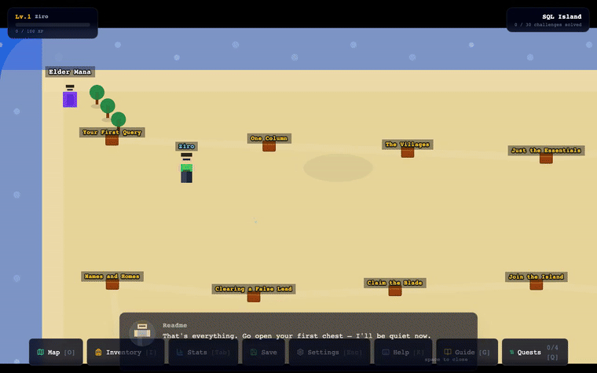

# Ziro's Tech Odyssey

A browser-based learning game, not a quiz app. A portal drops the player, Ziro, onto Tech Planet — 13 zones, each broken in its own way (a corrupted database, a CI pipeline on fire, a hospital system that won't validate records, an IoT fleet gone dark). You fix it by actually doing the work: real SQL against a real database, real Python run by a real interpreter, real terminal commands, architecture-ordering puzzles, and quick concept checks — never multiple choice standing in for the real thing.



## Table of contents

- [Why it's not a quiz app](#why-its-not-a-quiz-app)
- [The 13 zones](#the-13-zones)
- [The chest-rotation system](#the-chest-rotation-system)
- [Cross-cutting side quests](#cross-cutting-side-quests)
- [Accessibility & settings](#accessibility--settings
- [Running it locally](#running-it-locally)
- [Project structure](#project-structure)
- [Stack](#stack)
- [More gifs](#more-gifs)

## Why it's not a quiz app

Every challenge kind in the game is checked against the real thing, not a canned answer string:

| Kind | What actually runs |
|---|---|
| `sql` | A real SQLite database compiled to WebAssembly ([sql.js](https://sql.js.org/)). The player's own `INSERT`/`UPDATE`/`DELETE` queries genuinely mutate it, and that state persists across the whole SQL Island playthrough — break something in chest 3, and it's still broken in chest 12 unless you fixed it. |
| `python` | A real CPython interpreter compiled to WebAssembly ([Pyodide](https://pyodide.org/)). The player's code actually executes; results are read back through Pyodide's FFI and deep-compared, not scraped from printed text. |
| `code` | Dockerfiles, Terraform, YAML, HTML/CSS/JS, JSON — validated by structure/pattern against what a real reviewer would check for, not an exact-string match. |
| `terminal` | A fake shell that still has to match real command syntax (git, docker, kubectl, AWS CLI) step by step. |
| `sequence` | Architecture and process ordering — CI/CD pipelines, incident response, data pipelines, OAuth flows — built by reordering real steps, not picking from a list. |
| `mcq` / `matching` | Quick concept checks for things that don't have a single "run it and see" answer (e.g. the CAP theorem, HIPAA covered entities). Every one of these was independently fact-checked against real domain sources during development, not hand-waved. |

All five code-executing kinds share one Monaco editor instance — the same editor engine behind VS Code — self-hosted with no CDN dependency, so the whole game genuinely works offline.

## The 13 zones

| # | Zone | Real tech |
|---|---|---|
| 1 | SQL Island | SQL fundamentals → window functions, CTEs, transactions |
| 2 | Code Kingdom | Git, Docker, CI/CD, Kubernetes, Terraform |
| 3 | Python Jungle | Python fundamentals → comprehensions, dataclasses, asyncio |
| 4 | Data Realm | dbt, Airflow, Kafka, Spark, star-schema modeling |
| 5 | Cloud Citadel | AWS architecture, IAM, CloudFormation, Lambda |
| 6 | Algorithm Dungeon | Classic DSA — sorting, graphs, DP, Union-Find |
| 7 | AI Frontier | Hand-rolled ML math (no numpy/sklearn) — sigmoid, gradient descent, RAG |
| 8 | Healthcare Highlands | HIPAA, HL7, FHIR resource modeling |
| 9 | Supply Chain Docks | Incoterms, EOQ, reorder points, warehouse ops |
| 10 | IoT Outpost | MQTT, AWS IoT Core, edge computing, OTA rollouts |
| 11 | Web Dev Workshop | Semantic HTML, Flexbox/Grid, async JS, REST vs. GraphQL |
| 12 | Security Stronghold | OWASP, JWT/OAuth, TLS, zero trust |
| 13 | Collaboration Commons | Jira, agile ceremonies, RACI, OKRs |

Every zone is unlocked from the start — travel anywhere immediately via the Overworld map (`O`), no grinding required to reach the content you actually want. Across all 13 zones there are **~210 main-pool challenges**, each with 3 hints (the last one a full working solution — no shame in using it), verified by automated tests that run every challenge's real `check()` logic against a real interpreter, not a mock.

## The chest-rotation system

Every zone also has a bonus reserve pool sized at **2x its real chest count** — new content covering concepts the main pool doesn't, mixing hands-on challenges with MCQ/matching. Once a chest is solved and you move past it, that position quietly rotates to a fresh bonus-pool challenge; backtrack to it and you'll find something new. The cycle is a 3-step loop (original → bonus draw 1 → bonus draw 2 → original → …) rather than exhausting randomly, so a completionist pass through a zone is well-defined and repeatable.

Bonus-pool content is lazily fetched per zone (not bundled into the initial page load) — a player who only ever visits 3 zones never downloads the other 10 zones' bonus content.

## Cross-cutting side quests

Four quests reward connecting what you learn *across* zones instead of grinding one. Each just names three real challenges spanning three different zones, and auto-completes the instant all three are solved, in any order:

- **The Observability Tour** — Cloud Citadel + Data Realm + Security Stronghold
- **Full-Stack Debugger** — Code Kingdom + Web Dev Workshop + Healthcare Highlands
- **The Data Lifecycle** — SQL Island + Data Realm + AI Frontier
- **Security, Everywhere** — Cloud Citadel + Healthcare Highlands + Web Dev Workshop (deliberately *not* the Security Stronghold — the point is that security shows up everywhere)

No new content to author or grind — it's a pure meta-layer over challenges you're already solving, tracked in the Quest Log (`Q`).

## Accessibility & settings

- **Control remapping** — rebind movement/run/interact to any key; arrow keys always work as a fallback, so a bad rebind can never lock you out of moving.
- **Large text** and **reduce motion** toggles.
- **Audio** — fully procedural, synthesized in the browser via the Web Audio API (no audio files), with master/music/SFX volume and mute.
- A full keyboard shortcut reference is always one keypress away (`K`).

## Running it locally

```bash
npm install
npm run dev
```

Fully offline once dependencies are installed — no backend, no API calls, no account required. Progress saves to `localStorage`.

```bash
npm run build   # production build
npm run lint    # oxlint
npm test        # vitest
```

## Project structure

```
src/
  components/        React UI — HUD, challenge panels, menus, quiz/pipeline/code editors
  game/               Phaser layer — one generic ZoneScene reused for all 13 zones,
                      entities (Player/NPC/Chest), particle/audio-trigger systems
  store/              Zustand store — the single source of truth for progress, saves,
                      the chest-rotation mechanic, and quest tracking
  data/               Every zone's challenges + bonus pools + quests + glossary,
                      as plain data — the engine never hardcodes zone-specific logic
  utils/              sql.js/Pyodide/Monaco self-hosting, audio synthesis, keybinds
```

The engine is intentionally zone-agnostic: `ZoneScene.js` and `ChallengePanelRouter.jsx` don't know anything about SQL Island or Security Stronghold specifically — they just read whatever a zone's data file describes. Adding a 14th zone means writing a data file, not touching engine code.

## Stack

React 19 · Vite · Phaser (movement/chests/NPCs) · Zustand (state) · sql.js · Pyodide · Monaco Editor · Tailwind CSS v4 · Framer Motion · Vitest · oxlint.

## More gifs

Individual feature clips — chest-solving, the SQL challenge panel, the Quest Log, the Overworld map, level-ups, and the ending — are in [`docs/gifs/`](docs/gifs/).
